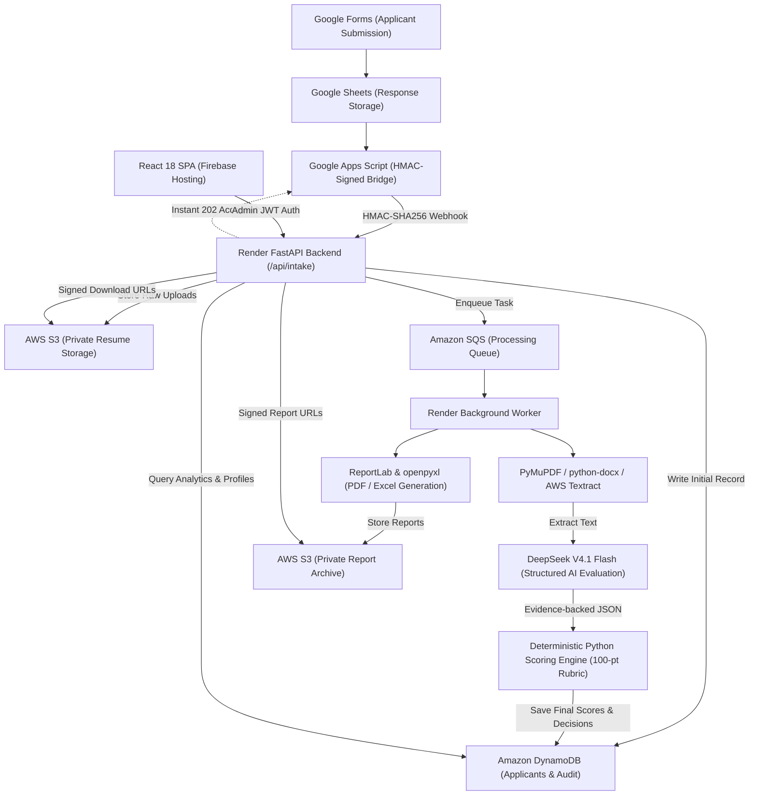

# System Architecture: AWS Student Builder Group AI Recruitment Platform

**Organization:** AWS Student Builder Group  
**Institution:** SJB Institute of Technology (SJBIT), Bengaluru, India  
**Recruitment Cycle:** 2026–27  

---

## 1. End-to-End System Architecture

---

## 2. Core Components

### A. Intake Layer
- **Google Forms & Sheets:** Standard student application form with resume file upload.
- **Google Apps Script Bridge (`integrations/google-apps-script/Code.gs`):** Captures form responses, retrieves files from Google Drive, calculates an HMAC-SHA256 signature, and sends the payload to FastAPI. Includes an offline Drive-based queue for automatic retry.
- **FastAPI Intake Endpoint (`/api/intake`):** Validates the signature, ensures idempotency, uploads files to S3, writes initial records to DynamoDB, and enqueues a background job. Responds with `202 Accepted` in < 200ms.

### B. Storage & Database (AWS)
- **Amazon DynamoDB:**
  - `sbg-applicants`: Partition Key `applicant_id`. Stores personal details, form responses, processing state, scores, recommendations, and reviewer decisions.
  - `sbg-evaluations`: Partition Key `applicant_id`, Sort Key `evaluation_id`. Stores rubric versions, criterion breakdowns, evidence citations, AI reasoning, and audit history.
  - `sbg-audit`: Partition Key `applicant_id`, Sort Key `audit_id`. Immutable log of all score modifications, reviews, and document downloads.
  - `sbg-config`: Stores editable rubric definitions, role weights, eligibility criteria, and field mappings.
  - `sbg-reports`: Stores catalog of generated reports.
- **Amazon S3:** Private buckets with server-side encryption (SSE-KMS) and blocked public access.
  - `sbg-resumes`: Secure candidate resumes and extracted text.
  - `sbg-reports`: Consolidated and individual candidate PDF/Excel files.

### C. Processing & AI Engine
- **Document Extractor (`backend/src/documents/extractor.py`):**
  - Digital PDFs parsed with **PyMuPDF**.
  - Word documents parsed with **python-docx**.
  - Scanned images and complex layout resumes processed with **Amazon Textract** OCR.
- **DeepSeek V4.1 Flash AI (`backend/src/ai/client.py`):**
  - OpenAI-compatible API interface with configurable base URL and model name.
  - Strict system prompt with anti-prompt-injection boundary markers.
  - Strict structured JSON response output with automatic retry validation.
  - Evaluates technical skills, projects, leadership, communication, and role suitability.
  - Extracts direct quotes as evidence for every score.
- **Deterministic Python Scoring Engine (`backend/src/scoring/engine.py`):**
  - 100-point rubric calculated entirely in Python (Relevant skills: 20, Projects & experience: 20, Role knowledge: 15, Problem solving: 15, Communication: 10, Commitment & availability: 10, Leadership: 10).
  - Role-specific weight adjustments.
  - AI may propose scores, but backend validates boundaries, applies penalties, and sets recommendation bands.

### D. Administrative Dashboard
- **React 18 + TypeScript + Vite + Tailwind CSS + shadcn/ui + TanStack Query + Recharts**.
- Hosted globally on **Firebase Hosting**.
- Role-based access control (Admin, Reviewer, Viewer).
- Real-time applicant pipeline status, multi-filter search, candidate profiling with resume preview, shortlisting, and Excel/PDF generation.

